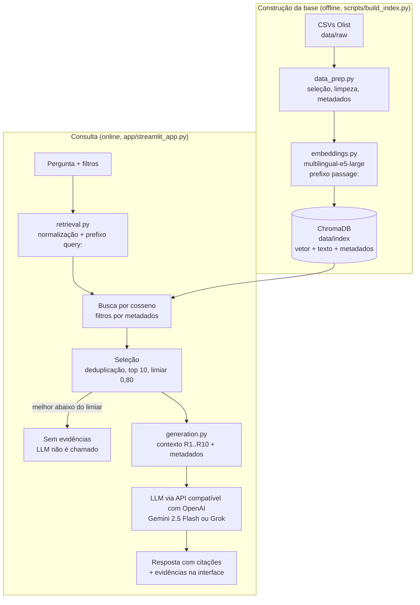

# Voice of Customer Intelligence com RAG

Tech Challenge — Fase 4 (POSTECH IA para Devs).

Solução baseada em **Retrieval-Augmented Generation (RAG)** para explorar, em linguagem natural, as avaliações de clientes do
[Brazilian E-Commerce Public Dataset by Olist](https://www.kaggle.com/datasets/olistbr/brazilian-ecommerce/data),
com respostas fundamentadas nas avaliações recuperadas e exibição das evidências usadas.

## Equipe

| Nome | RM | GitHub |
|------|----|--------|
|      |    |        |

## Problema de negócio

Gestores e analistas precisam identificar rapidamente os principais problemas, elogios e padrões presentes em milhares de
avaliações textuais. A nota (1 a 5) mostra o nível de satisfação, mas não o motivo; ler os comentários manualmente não escala.
A solução transforma esses comentários em uma base de conhecimento consultável, permitindo perguntas como:

- Quais são os principais problemas relatados pelos clientes?
- Quais reclamações relacionadas à entrega aparecem com maior frequência?
- O que os clientes mais elogiam em suas experiências de compra?
- Existem padrões recorrentes nas avaliações relacionadas à qualidade dos produtos?

Cada resposta cita as avaliações que a sustentam, e o sistema declara quando não há evidências suficientes.

## Arquitetura



| Etapa do fluxo | Implementação |
|---|---|
| Processamento da pergunta | `retrieval.transform_query` |
| Representação vetorial | `embeddings.embed_query` / `embed_documents` |
| Recuperação das avaliações | `retrieval.retrieve` (ChromaDB) |
| Construção do contexto | `generation.build_context` |
| Geração da resposta | `generation.generate_answer` |
| Orquestração e tratamento de falta de evidências | `pipeline.answer` |

## Estrutura do repositório

```
.
├── .streamlit/config.toml  # Tema da interface (claro/escuro)
├── app/streamlit_app.py    # Interface em chat: pergunta, filtros, etapas do RAG, resposta e evidências
├── data/
│   ├── raw/                # CSVs do Kaggle (não versionados)
│   ├── processed/          # Documentos preparados (não versionados)
│   └── index/              # Banco vetorial persistido (não versionado)
├── docs/
│   ├── exemplos.md         # Perguntas e respostas reais com evidências
│   └── roteiro_video.md    # Roteiro do vídeo de apresentação
├── notebooks/              # Análise exploratória e experimentos
├── scripts/build_index.py  # Preparação dos dados + indexação
├── src/voc_rag/
│   ├── config.py           # Caminhos, modelos e parâmetros (top-k, limiar)
│   ├── data_prep.py        # Seleção, limpeza e organização dos documentos
│   ├── embeddings.py       # Embeddings com e5
│   ├── indexing.py         # Indexação no ChromaDB
│   ├── retrieval.py        # Transformação da pergunta, filtros e busca
│   ├── generation.py       # Contexto, prompt e chamada ao LLM
│   └── pipeline.py         # Orquestração do fluxo RAG
└── tests/                  # Testes automatizados (pytest)
```

## Tecnologias e bibliotecas

| Componente | Escolha | Justificativa |
|------------|---------|---------------|
| Linguagem | Python 3.11+ | Ecossistema padrão para dados e IA |
| Manipulação de dados | pandas + pyarrow | Junção das tabelas da Olist e persistência dos documentos em Parquet |
| Embeddings | `intfloat/multilingual-e5-large` (sentence-transformers) | Treinado para busca (query → documento), multilíngue com bom desempenho em português, gratuito, roda localmente e garante reprodutibilidade sem chave de API. Escolhido após comparação com o e5-small ([ver abaixo](#escolha-do-modelo-de-embeddings-e5-small--e5-large)) |
| Banco vetorial | ChromaDB (persistido em `data/index/`) | Volume (~41 mil avaliações) não justifica servidor; armazena vetor, texto e metadados juntos; filtro nativo por metadados (nota, entrega, categoria); roda localmente, facilitando a reprodução |
| LLM | Via API compatível com OpenAI (`openai` SDK). Padrão: Gemini 2.5 Flash (camada gratuita). Exemplos e demonstração: Grok `grok-4.20-0309-non-reasoning` (xAI) | O Gemini permite rodar sem custo; a camada gratuita, porém, esgotou durante o desenvolvimento (limite diário baixo), e os exemplos foram gerados com o Grok (pago por uso, ~1 s por resposta). A troca foi feita só pelo `.env` (`LLM_BASE_URL`, `LLM_API_KEY`, `LLM_MODEL`), sem alterar código |
| Interface | Streamlit | Interface web em Python puro, suficiente para perguntas, filtros e exibição das evidências |
| Testes | pytest | Testes da preparação dos dados, dos filtros e do tratamento de falta de evidências |

## Preparação da base de conhecimento

Implementado em `src/voc_rag/data_prep.py`, `embeddings.py` e `indexing.py`; executado por `scripts/build_index.py`.

- **Seleção dos dados:** a base textual vem de `olist_order_reviews_dataset.csv` (99.224 avaliações). Ela é enriquecida com
  `olist_orders_dataset.csv` (datas de compra e entrega), `olist_order_items_dataset.csv` + `olist_products_dataset.csv`
  (categoria do produto) e `product_category_name_translation.csv`. Clientes, vendedores, pagamentos e geolocalização não
  contribuem para as perguntas do desafio e foram descartados.
- **Limpeza e preparação dos textos:** título e comentário são unidos em um único texto (o título costuma resumir a
  avaliação). Quebras de linha (`\r\n`) e espaços repetidos são normalizados. Acentos e caixa são preservados, pois o e5
  é treinado com texto natural.
- **Tratamento de valores ausentes:** 57% das avaliações têm apenas a nota, sem texto, e são descartadas porque não
  contribuem com conteúdo para o RAG. Textos com menos de 3 letras ("A", "10", "OK") também são descartados. Metadados
  ausentes recebem um valor explícito (categoria `desconhecida`, entrega `nao_entregue`) ou são omitidos (dias de atraso
  de pedidos não entregues).
- **Organização dos documentos:** 1 documento = 1 avaliação, resultando em **41.973 documentos**. Os comentários são
  curtos (mediana de 53 caracteres, máximo de 208), então não há chunking. O mesmo `review_id` aparece em mais de um
  pedido com o mesmo texto e é deduplicado. Metadados por documento: `review_score`, `review_date`, `purchase_month`,
  `order_status`, `delivery_status` (`no_prazo` / `atrasado` / `nao_entregue`), `delivery_delay_days` e
  `product_category` (do primeiro item do pedido; cerca de 3% dos pedidos têm mais de um produto).
- **Criação dos embeddings:** `intfloat/multilingual-e5-large` (560 milhões de parâmetros, vetores de 1024 dimensões),
  com o prefixo `passage: ` nos documentos e `query: ` nas perguntas, conforme o treinamento do modelo. Os vetores são
  normalizados. A indexação completa leva cerca de 30 minutos em CPU (é feita uma única vez).
- **Armazenamento e indexação:** ChromaDB persistido em `data/index/`, com similaridade de cosseno (HNSW). Cada registro
  guarda o vetor, o texto e os metadados, permitindo filtros como `review_score <= 2` ou uma categoria específica.
  O índice é recriado a cada execução de `build_index.py`.

## Estratégia do pipeline RAG

Implementado em `src/voc_rag/retrieval.py`, `generation.py` e `pipeline.py`.

- **Transformação da pergunta:** normalização de espaços e prefixo `query: ` exigido pelo e5.
- **Recuperação semântica:** busca por similaridade de cosseno no ChromaDB, com filtros opcionais por metadados.
  São buscados 30 candidatos (3× o top-k) para compensar textos repetidos.
- **Seleção dos conteúdos mais relevantes:** remoção de textos idênticos (ex.: vários "Muito bom"), que ocupariam
  espaço no contexto sem trazer informação nova; ficam as **10** avaliações mais similares.
- **Construção do contexto:** cada avaliação recebe um identificador (`[R1]`, `[R2]`...) e vai acompanhada de nota,
  situação da entrega e categoria, para que o modelo relacione o comentário ao contexto do pedido.
- **Geração da resposta:** o prompt de sistema exige resposta baseada exclusivamente nas avaliações, com citação dos
  identificadores em cada afirmação. Como as 10 avaliações são uma amostra, o prompt proíbe afirmar quantidades ou
  frequências ("a maioria", "8 de 10"): nos primeiros testes o modelo escreveu "a maioria dos clientes" a partir de 10
  avaliações, e errou uma contagem. Temperatura 0 para respostas estáveis e menos criativas.
- **Rastreabilidade:** cada citação `[R1]` na resposta é interativa: ao passar o mouse (ou focar/tocar), mostra o texto
  completo da avaliação, nota, situação da entrega, categoria, data e similaridade (componente customizado do Streamlit,
  `app/citations.py`). Abaixo da resposta, uma tabela lista todas as evidências.

### Perguntas sem evidências suficientes

São usadas duas camadas, porque a similaridade sozinha não separa as perguntas pelo escopo:

1. **Limiar de similaridade (0,80) sobre a melhor evidência:** se a avaliação mais similar não alcança o limiar, o
   sistema responde que não há evidências e **não chama o LLM**; se alcança, as 10 recuperadas vão para o contexto.
2. **Instrução no prompt:** o modelo só responde com base nas avaliações e declara falta de evidências quando nenhuma
   delas trata do tema da pergunta (ou quando a pergunta não é sobre a experiência de compra).

**Calibração.** Foram medidas 15 perguntas do escopo (incluindo variações de redação da mesma pergunta) e 15 sem
relação, com o e5-large. A similaridade da melhor avaliação ficou entre **0,832 e 0,948** para as do escopo e entre
**0,773 e 0,889** para as sem relação: as faixas se sobrepõem. "Me recomende um filme" (0,889) supera a maioria das
perguntas válidas, porque "recomendo" é frequente nas avaliações; e duas palavras mudam o resultado ("...mais
elogiados?" 0,848 × "...mais elogiados pelos clientes?" 0,860).

| Limiar | Perguntas válidas barradas | Perguntas sem relação barradas sem chamar o LLM |
|---|---|---|
| 0,85 | 2 de 15 | 13 de 15 |
| **0,80 (adotado)** | **0 de 15** | 4 de 15 |

Recusar uma pergunta válida é pior do que gastar uma chamada ao LLM com uma pergunta sem relação, então o limiar foi
fixado em 0,80: barra sem custo apenas as perguntas muito distantes, e o LLM é a camada principal de recusa. Nos testes,
ele recusou todas as perguntas sem relação que passaram do limiar, inclusive "Me recomende um filme".

| Pergunta | Similaridade (top 1) | Resultado |
|---|---|---|
| Qual a capital da França? | 0,773 | Barrada pelo limiar, sem chamar o LLM |
| Qual a previsão do tempo para amanhã? | 0,834 | Passa do limiar; o LLM declara que não há evidências |
| Me recomende um filme | 0,889 | Passa do limiar; o LLM declara que não há evidências |

O limiar é aplicado à melhor evidência, e não a cada uma: em perguntas abstratas, as 10 evidências têm scores muito
próximos (ex.: 0,843 a 0,852), e um corte individual chegou a deixar apenas 1 evidência para uma pergunta válida.
O valor fica em `config.MIN_SIMILARITY` e depende do modelo de embeddings: ao trocar de modelo, a calibração deve ser refeita.

### Escolha do modelo de embeddings: e5-small × e5-large

A solução começou com o `multilingual-e5-small` e foi comparada com o `multilingual-e5-large` nas mesmas perguntas
(primeira bateria: 9 do escopo e 8 sem relação), com os mesmos dados e parâmetros:

| Critério | e5-small (118M) | e5-large (560M) |
|---|---|---|
| Similaridade da melhor avaliação, perguntas do escopo | 0,863 a 0,962 | 0,852 a 0,948 |
| Similaridade da melhor avaliação, perguntas sem relação | 0,816 a **0,877** | 0,773 a **0,850** |
| "Qual a previsão do tempo para amanhã?" | 0,877 (casava com "previsão de entrega") | 0,834 |
| "Quais são os principais problemas relatados?" | 1ª evidência era uma avaliação nota 5 | 9 de 10 evidências nota 1, todas reclamações |
| "Padrões nas avaliações de clientes insatisfeitos?" | Recuperava "como vou *avaliar* se não recebi?" (o termo "avaliações" dominava) | Recupera "falta de respeito com o cliente", "não estou satisfeita com a qualidade" |
| Indexação em CPU (41.973 textos) | ~3,5 min | ~31 min |
| Tamanho do modelo | ~0,5 GB | ~2,2 GB |

O e5-large separa melhor perguntas relevantes de irrelevantes e captura a intenção da pergunta em vez de palavras
isoladas. O custo maior está na indexação, feita uma única vez; na consulta, apenas a pergunta é convertida em vetor.

### Desafio adicional: metadados

A interface oferece filtros por **nota**, **categoria do produto** e **situação da entrega** (`retrieval.build_filters`),
aplicados pelo ChromaDB **antes** da busca semântica. Os demais metadados (datas, dias de atraso, status do pedido)
acompanham cada evidência e entram no contexto enviado ao LLM.

Como os metadados melhoram a recuperação:

- **Precisão:** a similaridade semântica captura o assunto, mas não o sentimento. Uma busca por "problemas com o produto"
  também traz avaliações neutras ou positivas que mencionam o tema; com `nota ≤ 2`, o espaço de busca fica restrito a
  clientes insatisfeitos de forma determinística, sem depender do texto.
- **Análises segmentadas:** perguntas como "o que os clientes elogiam em móveis e decoração?" ou "quais temas aparecem
  em entregas atrasadas?" passam a ser respondidas com evidências apenas do segmento pedido.
- **Contexto para o LLM:** nota, entrega e categoria junto a cada comentário permitem que a resposta relacione o relato ao
  pedido (ex.: distinguir reclamação de atraso real de ansiedade antes do prazo).

A situação da entrega (`no_prazo`, `atrasado`, `nao_entregue`) é derivada comparando a data de entrega real com a estimada,
e não existe pronta na base.

## Instalação e execução

Pré-requisitos: Python 3.11+ e uma chave de API do Gemini ([Google AI Studio](https://aistudio.google.com/apikey),
camada gratuita), do Grok ([xAI](https://console.x.ai)) ou de outro provedor compatível com a API da OpenAI. Exemplos de
configuração de cada provedor estão no `.env.example`.

```bash
git clone https://github.com/LucasAlexSant/tech-challenge-fase4.git
cd tech-challenge-fase4

python -m venv .venv
# Windows: .venv\Scripts\activate | Linux/macOS: source .venv/bin/activate
pip install -r requirements.txt

cp .env.example .env   # Windows: copy .env.example .env — depois preencha LLM_API_KEY
```

1. Baixe o dataset e extraia os CSVs em `data/raw/`, pelo [Kaggle](https://www.kaggle.com/datasets/olistbr/brazilian-ecommerce/data)
   ou pela linha de comando:
   ```bash
   curl -L -o olist.zip https://www.kaggle.com/api/v1/datasets/download/olistbr/brazilian-ecommerce
   unzip olist.zip -d data/raw   # Windows: Expand-Archive olist.zip data/raw
   ```
2. Construa a base de conhecimento (cerca de 30 minutos em CPU; o modelo e5-large, ~2,2 GB, é baixado na primeira
   execução). Para uma execução mais rápida, use `EMBEDDING_MODEL=intfloat/multilingual-e5-small` no `.env` (~4 minutos,
   com recuperação inferior; ver comparação acima):
   ```bash
   python scripts/build_index.py
   ```
3. Rode a interface e acesse http://localhost:8501:
   ```bash
   streamlit run app/streamlit_app.py
   ```
4. Rode os testes:
   ```bash
   pytest
   ```

Parâmetros ajustáveis em `src/voc_rag/config.py`: `TOP_K` (avaliações por pergunta) e `MIN_SIMILARITY` (limiar).

## Exemplos de perguntas e respostas

Respostas reais da solução, com as evidências recuperadas, estão em [docs/exemplos.md](docs/exemplos.md). Resumo:

| Pergunta | Filtros | Resultado |
|---|---|---|
| Quais são os principais problemas relatados pelos clientes? | — | Atraso ou não entrega, falta de respeito com o cliente, dificuldade de rastreio, produto errado ou incompleto |
| O que os clientes relatam sobre problemas relacionados à entrega? | — | Problemas com Correios e transportadoras, endereço não localizado, entrega incompleta, falta de explicação |
| Quais aspectos da experiência de compra são mais elogiados? | — | Entrega antes do prazo, qualidade conforme o anúncio, atendimento, facilidade da compra, preço e embalagem |
| Quais padrões nas avaliações de clientes insatisfeitos? | — | Descaso com o cliente, problemas de entrega, qualidade ou descrição do produto |
| Quais avaliações sustentam problemas recorrentes com o prazo de entrega? | — | Lista as avaliações sobre prazo, mas conclui que são relatos individuais e não sustentam recorrência (uma delas diz que foi "a primeira vez") |
| Quais são os principais problemas nas avaliações com nota baixa? | nota ≤ 2 | Problemas de entrega, falta de comunicação, baixa qualidade, nota fiscal |
| O que os clientes mais elogiam nos produtos? | nota ≥ 4, `moveis_decoracao` | Qualidade, acabamento e beleza dos produtos |
| Qual a capital da França? | — | Barrada pelo limiar; o LLM não é chamado |
| Qual a previsão do tempo para amanhã? / Me recomende um filme | — | Passam do limiar; o LLM declara que não há evidências na base |

## Principais decisões técnicas e desafios

- **1 avaliação = 1 documento, sem chunking:** os comentários têm no máximo 208 caracteres. Dividir não traria ganho e
  quebraria a rastreabilidade (cada evidência corresponde a uma avaliação identificável).
- **Descartar avaliações sem texto:** 57% da base tem apenas a nota. Elas não têm conteúdo para recuperar e, se
  indexadas com texto vazio, poluiriam a busca.
- **Modelos locais para embeddings, LLM via API:** embeddings precisam ser gerados para toda a base (41 mil textos), então
  um modelo local evita custo e limites de requisição; o LLM é chamado uma vez por pergunta.
- **Desafio: calibrar a detecção de perguntas sem evidência.** O e5 produz similaridades concentradas em faixa alta
  (0,77 a 0,96). Uma primeira calibração com poucas perguntas sugeriu limiar 0,85, que depois recusou uma pergunta
  válida (um dos exemplos da interface, com 0,848). Ampliando para 15 + 15 perguntas, ficou claro que as faixas se
  sobrepõem; o limiar foi reduzido para 0,80 (nenhuma válida barrada) e o LLM passou a ser a camada principal de recusa.
- **Desafio: o LLM generalizava a partir da amostra.** Com 10 avaliações, o modelo escrevia "a maioria dos clientes" e
  chegou a errar uma contagem. O prompt passou a proibir quantidades e frequências e a pedir que, em perguntas sobre
  recorrência, apresente as avaliações e explique que elas não medem frequência na base.
- **Desafio: textos repetidos.** Avaliações curtas como "Muito bom" aparecem centenas de vezes e ocupavam várias posições
  do top-k com o mesmo conteúdo. A busca recupera 3× mais candidatos e remove duplicatas antes de montar o contexto.
- **Desafio: palavras da pergunta que não são o assunto.** Com o e5-small, "Quais padrões podem ser identificados nas
  *avaliações* de clientes insatisfeitos?" recuperava "como vou *avaliar* se não recebi?": o termo "avaliações" dominava
  o embedding, e o filtro `nota ≤ 2` não resolvia, porque esses textos também têm nota baixa. Esse foi o principal
  motivo para testar o e5-large, que recupera reclamações reais para a mesma pergunta.
- **Escolha do modelo validada por comparação:** e5-small e e5-large foram comparados nas mesmas perguntas (tabela na
  seção do pipeline). O large foi mantido apesar da indexação ~9× mais lenta, porque ela ocorre uma única vez.
- **Desafio: disponibilidade da camada gratuita do Gemini.** O alias `gemini-flash-latest` não respondia (a solução fixa
  `gemini-2.5-flash` e define timeout de 60 s); depois, a cota diária gratuita esgotou após cerca de 10 chamadas
  (HTTP 429) e houve sobrecarga temporária (HTTP 503). A interface exibe essas falhas como erro, sem derrubar o app.
- **Provedor de LLM desacoplado, na prática:** por causa da cota, os exemplos foram gerados com o Grok (xAI) trocando
  apenas três variáveis do `.env`, sem alterar código. O mesmo vale para OpenAI, Ollama ou Groq.

### Limitações e próximos passos

- **Avaliação quantitativa:** criar um conjunto de perguntas com avaliações relevantes anotadas para medir a recuperação
  (precision@k) e a fidelidade das respostas, em vez de inspeção manual.
- **Busca híbrida e reranking:** combinar BM25 com a busca vetorial e reordenar com um cross-encoder para melhorar a
  precisão em termos específicos (nomes de produtos, prazos).
- **Transformação da pergunta com LLM:** reescrever perguntas abstratas ("quais os principais problemas?") em termos
  próximos aos das avaliações e classificar o escopo antes da busca, reduzindo a dependência do limiar.
- **Frequência dos temas:** o top-k mostra exemplos representativos, não contagens. Para "o que aparece com maior
  frequência", uma etapa de agrupamento de temas sobre toda a base complementaria o RAG.
- **Escala:** para milhões de avaliações em produção, um banco vetorial servidor (Qdrant, pgvector) seria mais adequado.

## Vídeo de apresentação

> TODO: link do vídeo (até 7 minutos). Roteiro em [docs/roteiro_video.md](docs/roteiro_video.md).
