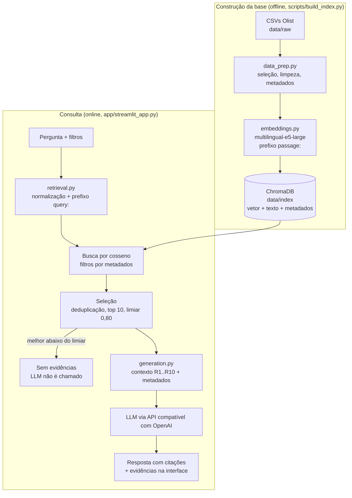

# Voice of Customer Intelligence com RAG

Tech Challenge — Fase 4 (POSTECH IA para Devs).

Solução **RAG** para perguntar, em linguagem natural, sobre as avaliações de clientes do
[Brazilian E-Commerce Public Dataset by Olist](https://www.kaggle.com/datasets/olistbr/brazilian-ecommerce/data).
Cada resposta cita as avaliações que a sustentam, e o sistema declara quando não há evidências suficientes.

## Problema de negócio

A nota (1 a 5) mostra *se* o cliente está satisfeito, mas não *por quê*; os motivos estão nos comentários, e lê-los
manualmente não escala. A solução transforma os comentários em uma base consultável para perguntas como "quais são os
principais problemas relatados?" ou "o que os clientes mais elogiam?".

## Arquitetura



| Etapa | Implementação |
|---|---|
| Processamento da pergunta | `retrieval.transform_query` |
| Representação vetorial | `embeddings.embed_query` / `embed_documents` |
| Recuperação | `retrieval.retrieve` (ChromaDB) |
| Construção do contexto | `generation.build_context` |
| Geração da resposta | `generation.generate_answer` |
| Orquestração e falta de evidências | `pipeline.answer` |

```
├── app/                  # Interface Streamlit (chat, filtros, citações interativas)
├── data/                 # raw/ (CSVs), processed/ (Parquet), index/ (ChromaDB) — não versionados
├── docs/exemplos.md      # Perguntas e respostas reais com evidências
├── scripts/build_index.py
├── src/voc_rag/          # config, data_prep, embeddings, indexing, retrieval, generation, pipeline
└── tests/                # pytest
```

## Tecnologias

| Componente | Escolha | Justificativa |
|---|---|---|
| Embeddings | `intfloat/multilingual-e5-large` | Treinado para busca, bom em português, gratuito e local (sem custo nem limite de API para 41 mil textos) |
| Banco vetorial | ChromaDB persistido | O volume não justifica servidor; guarda vetor, texto e metadados e filtra por metadados |
| LLM | API compatível com OpenAI (`openai` SDK) | Padrão: Gemini 2.5 Flash (gratuito). Exemplos gerados com Grok (`grok-4.20-0309-non-reasoning`) após a cota gratuita do Gemini esgotar; a troca é feita só pelo `.env` |
| Interface | Streamlit | Chat, filtros e evidências em Python |
| Dados e testes | pandas, pyarrow, pytest | Junção das tabelas, Parquet e testes automatizados |

## Preparação da base

- **Seleção:** `olist_order_reviews_dataset.csv` (99.224 avaliações), enriquecida com pedidos (datas), itens e produtos
  (categoria). Clientes, vendedores, pagamentos e geolocalização não ajudam nas perguntas e foram descartados.
- **Limpeza:** título + comentário em um texto, com quebras de linha e espaços normalizados. Acentos e caixa são mantidos,
  porque o e5 é treinado com texto natural.
- **Valores ausentes:** 57% das avaliações têm só a nota e foram descartadas, assim como textos com menos de 3 letras
  ("A", "OK"). Metadados ausentes recebem valor explícito (categoria `desconhecida`, entrega `nao_entregue`).
- **Documentos:** 1 avaliação = 1 documento (**41.973**), deduplicados por `review_id`. Sem chunking: o maior comentário
  tem 208 caracteres (mediana 53). Metadados: nota, data, mês da compra, status do pedido, categoria e situação da
  entrega (`no_prazo` / `atrasado` / `nao_entregue`, derivada da data real × estimada).
- **Embeddings:** prefixos `passage: ` (documentos) e `query: ` (perguntas), como o e5 exige, com vetores normalizados.
  Indexação de ~30 min em CPU, feita uma única vez.
- **Indexação:** ChromaDB com cosseno (HNSW), recriado a cada execução de `build_index.py`.

## Pipeline RAG

1. **Transformação da pergunta:** normalização de espaços e prefixo `query: `.
2. **Recuperação semântica:** cosseno no ChromaDB, com filtros opcionais; busca 30 candidatos (3× o top-k).
3. **Seleção:** remove textos idênticos (ex.: vários "Muito bom") e mantém as **10** mais similares.
4. **Contexto:** cada avaliação recebe um ID (`[R1]`...) com nota, entrega e categoria.
5. **Geração:** o prompt exige resposta baseada só nas avaliações, citando os IDs, e proíbe afirmar quantidades ("a
   maioria"), já que 10 avaliações são uma amostra. Temperatura 0.

**Rastreabilidade:** cada `[R1]` da resposta mostra, ao passar o mouse, a avaliação completa com nota, entrega,
categoria, data e similaridade; uma tabela abaixo lista todas as evidências.

### Perguntas sem evidências suficientes

1. **Limiar de 0,80 na melhor evidência:** abaixo dele, o sistema responde que não há evidências e **não chama o LLM**.
2. **Prompt:** o LLM declara falta de evidências quando nenhuma avaliação trata do tema ou a pergunta está fora do escopo.

O limiar foi calibrado com 15 perguntas do escopo e 15 sem relação. As faixas de similaridade se sobrepõem
(escopo: 0,832–0,948; sem relação: 0,773–0,889 — "Me recomende um filme" chega a 0,889 porque "recomendo" é comum nas
avaliações), então nenhum limiar separa tudo:

| Limiar | Válidas barradas | Sem relação barradas pelo limiar |
|---|---|---|
| 0,85 | 2 de 15 | 13 de 15 |
| **0,80 (adotado)** | **0 de 15** | 4 de 15 |

Recusar uma pergunta válida é pior que gastar uma chamada ao LLM, por isso 0,80. Nos testes, o LLM recusou todas as
perguntas sem relação que passaram do limiar. O limiar é aplicado à melhor evidência, e não a cada uma, porque em
perguntas abstratas os scores ficam muito próximos e um corte individual chegou a deixar uma só evidência.

### Escolha do modelo de embeddings

| Critério | e5-small (118M) | e5-large (560M) |
|---|---|---|
| Melhor similaridade em perguntas sem relação | até 0,877 | até 0,850 |
| "Quais são os principais problemas relatados?" | 1ª evidência com nota 5 | 9 de 10 evidências com nota 1 |
| "Padrões de clientes insatisfeitos?" | "como vou *avaliar* se não recebi?" | "falta de respeito com o cliente" |
| Indexação em CPU | ~3,5 min | ~31 min |

O e5-large captura a intenção da pergunta, e não palavras isoladas. O custo extra é só na indexação, feita uma vez.

### Metadados (desafio adicional)

A interface filtra por **nota**, **categoria** e **situação da entrega** (`retrieval.build_filters`), aplicados pelo
ChromaDB antes da busca semântica.

- **Precisão:** a similaridade captura o assunto, não o sentimento. Com `nota ≤ 2`, a busca fica restrita a clientes
  insatisfeitos sem depender do texto.
- **Segmentação:** "o que elogiam em móveis e decoração?" ou "temas em entregas atrasadas?" passam a ter evidências só
  do segmento.
- **Contexto:** nota, entrega e categoria acompanham cada comentário, e o LLM distingue, por exemplo, atraso real de
  ansiedade antes do prazo.

## Instalação e execução

Pré-requisitos: Python 3.11+ e uma chave de API do Gemini ([Google AI Studio](https://aistudio.google.com/apikey)),
do Grok ([xAI](https://console.x.ai)) ou de outro provedor compatível com OpenAI (exemplos no `.env.example`).

```bash
git clone https://github.com/LucasAlexSant/tech-challenge-fase4.git
cd tech-challenge-fase4
python -m venv .venv
# Windows: .venv\Scripts\activate | Linux/macOS: source .venv/bin/activate
pip install -r requirements.txt
cp .env.example .env   # Windows: copy .env.example .env — depois preencha LLM_API_KEY
```

1. Baixe os CSVs do [Kaggle](https://www.kaggle.com/datasets/olistbr/brazilian-ecommerce/data) em `data/raw/`:
   ```bash
   curl -L -o olist.zip https://www.kaggle.com/api/v1/datasets/download/olistbr/brazilian-ecommerce
   unzip olist.zip -d data/raw   # Windows: Expand-Archive olist.zip data/raw
   ```
2. Construa a base (~30 min em CPU; o e5-large, ~2,2 GB, é baixado na primeira vez). Para testar rápido, use
   `EMBEDDING_MODEL=intfloat/multilingual-e5-small` no `.env` (~4 min, recuperação inferior):
   ```bash
   python scripts/build_index.py
   ```
3. Rode a interface em http://localhost:8501:
   ```bash
   streamlit run app/streamlit_app.py
   ```
4. Testes: `pytest`

`TOP_K` e `MIN_SIMILARITY` ficam em `src/voc_rag/config.py`. Ao trocar o modelo de embeddings, refaça a calibração do limiar.

## Exemplos de perguntas e respostas

Respostas completas, com as evidências, em [docs/exemplos.md](docs/exemplos.md).

| Pergunta | Filtros | Resultado |
|---|---|---|
| Quais são os principais problemas relatados pelos clientes? | — | Atraso ou não entrega, falta de respeito com o cliente, rastreio, produto errado ou incompleto |
| O que os clientes relatam sobre problemas relacionados à entrega? | — | Correios e transportadoras, endereço não localizado, entrega incompleta, falta de explicação |
| Quais aspectos da experiência de compra são mais elogiados? | — | Entrega antes do prazo, qualidade conforme o anúncio, atendimento, preço e embalagem |
| Quais avaliações sustentam problemas recorrentes com o prazo de entrega? | — | Lista as avaliações, mas não afirma recorrência (uma delas diz que foi "a primeira vez") |
| Quais são os principais problemas nas avaliações com nota baixa? | nota ≤ 2 | Entrega, falta de comunicação, baixa qualidade, nota fiscal |
| O que os clientes mais elogiam nos produtos? | nota ≥ 4, `moveis_decoracao` | Qualidade, acabamento e beleza |
| Qual a capital da França? | — | Barrada pelo limiar, sem chamar o LLM |
| Me recomende um filme | — | Passa do limiar; o LLM declara que não há evidências |

## Principais decisões e desafios

- **Sem chunking e sem avaliações vazias:** comentários curtos cabem inteiros, o que preserva a rastreabilidade; textos
  vazios só poluiriam a busca.
- **Embeddings locais, LLM via API:** embeddings são gerados para toda a base; o LLM é chamado uma vez por pergunta.
- **Calibração do limiar:** a primeira, com poucas perguntas, sugeriu 0,85 e recusou uma pergunta válida; com 15 + 15
  perguntas, o limiar foi para 0,80 e o LLM passou a ser a camada principal de recusa.
- **Generalização do LLM:** com 10 avaliações, o modelo escrevia "a maioria dos clientes" e errou uma contagem; o prompt
  passou a proibir quantidades.
- **Textos repetidos:** "Muito bom" aparecia centenas de vezes e ocupava o top-k; resolvido com 3× candidatos e
  deduplicação.
- **Cota do Gemini:** limite diário (HTTP 429) e sobrecarga (HTTP 503); a interface trata as falhas, e a troca para o Grok
  foi feita só pelo `.env`.

## Vídeo de apresentação

> TODO: link do vídeo (até 7 minutos).
